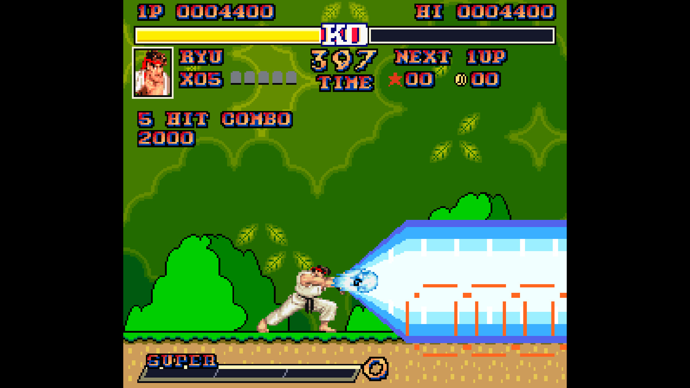
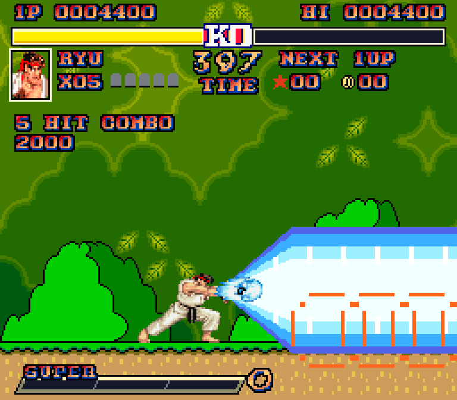
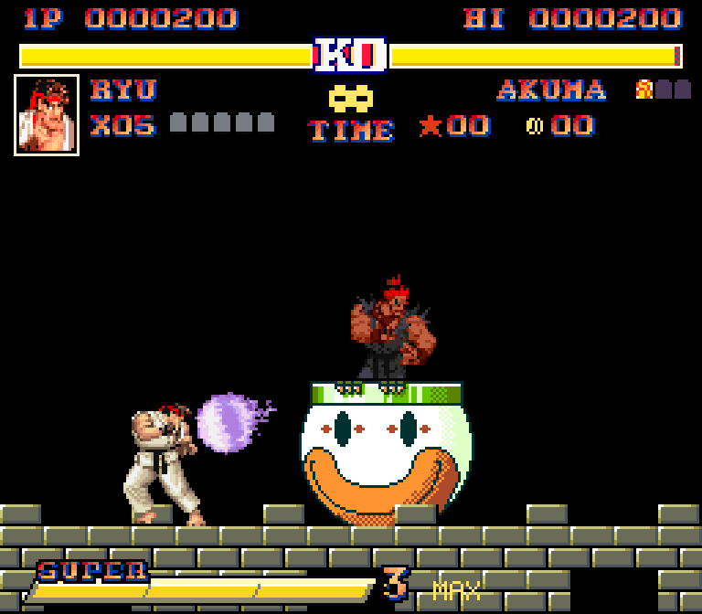
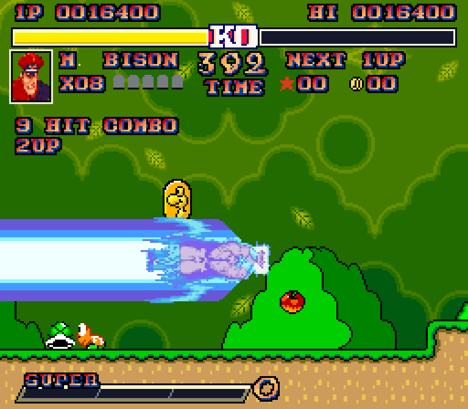
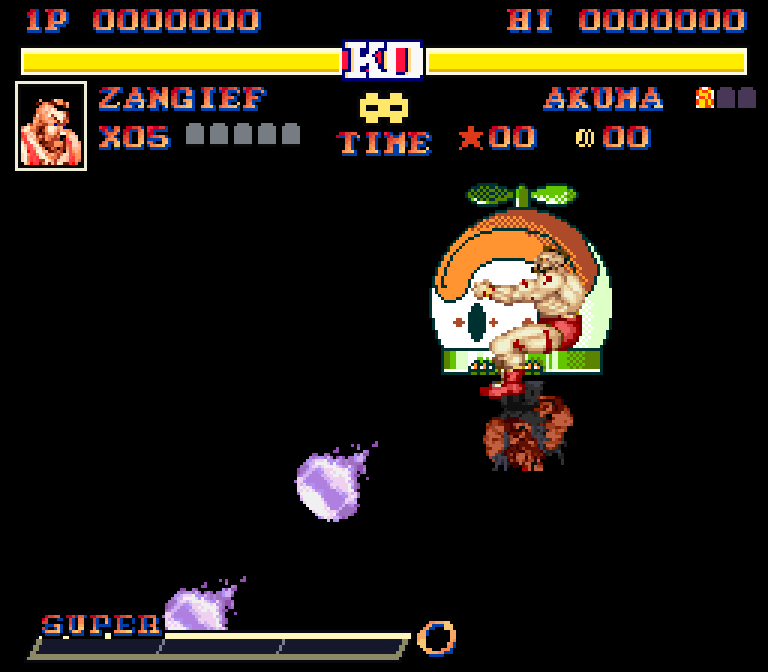

# Super Mario World II — The World Warrior

Hadoukens in Dinosaur Land. Twelve Street Fighter fighters take on Super Mario
World’s original levels with arcade combat, a three-bar super meter, and an
Akuma finale that gets completely out of hand.

**[Play in your browser](https://mikolalysenko.github.io/smw-street-fighter/)** ·
**[Download for desktop](https://github.com/mikolalysenko/smw-street-fighter/releases/latest)** ·
**[Watch the teaser](https://mikolalysenko.github.io/smw-street-fighter/media/teaser.mp4)**

## Pick a fighter. Break the rules.

- **The original world.** Mario’s levels, secrets, enemies, Yoshi, music and overworld, with Street Fighter sprites, voices and hit reactions.
- **All twelve fighters.** Ryu, Honda, Chun-Li, Guile, Ken, Blanka, Zangief, Dhalsim, Balrog, Vega, Sagat and M. Bison. Each has their own moves and ending.
- **Three levels of super.** Fire a giant Shinku Hadouken beam, fly across a stage with Psycho Crusher, or piledrive a warp pipe. Mushrooms, flowers and feathers charge your meter.
- **An entirely different final fight.** Akuma takes Bowser’s clown car. Dodge his fireballs, hit them back, and find openings between attack waves. Zangief can grab the whole car.
- **Arcade rewards.** Health bars, parries, escalating combos, a PERFECT bonus, fighter-specific continues and a persistent high score.
- **Play where you want.** Keyboard, gamepad or phone touch controls. Fullscreen for the TV. The browser and desktop versions run the same game.

| A familiar world, different rules | The final challenger |
| --- | --- |
|  |  |
|  |  |

## Start playing

The **[browser version](https://mikolalysenko.github.io/smw-street-fighter/)** needs no installation.
Click **Play**, start a one-player game, choose a save file, then pick your fighter.
Use **Jump** to confirm menus and dismiss Mario’s introduction.

On a phone, tap **Play** to enable sound. Touch controls appear automatically;
turn sideways and tap **Expand** for a larger play area. A gamepad also works in
supported browsers. WebGPU is optional—the game has a Canvas fallback.

### Desktop downloads

Every desktop download includes the game data and SDL runtime. Extract the
**whole** archive before launching; there is nothing to compile.

| Platform | Download | Launch |
| --- | --- | --- |
| macOS · Apple Silicon | [ARM64 ZIP](https://github.com/mikolalysenko/smw-street-fighter/releases/latest/download/super-mario-world-ii-macos-arm64.zip) | Move the app to Applications and open it. |
| macOS · Intel | [x86-64 ZIP](https://github.com/mikolalysenko/smw-street-fighter/releases/latest/download/super-mario-world-ii-macos-x86_64.zip) | Move the app to Applications and open it. |
| Linux · x86-64 | [TAR.GZ](https://github.com/mikolalysenko/smw-street-fighter/releases/latest/download/super-mario-world-ii-linux-x86_64.tar.gz) | Run `./play.sh`; add `--fullscreen` for the TV. |
| Windows · x86-64 | [ZIP](https://github.com/mikolalysenko/smw-street-fighter/releases/latest/download/super-mario-world-ii-windows-x86_64.zip) | Open `Super Mario World II.exe`. |

These community builds are not publisher-signed. If macOS blocks the app, open
**System Settings → Privacy & Security** to review it. See the release notes for
OS requirements and checksums.

For Bazzite or Steam Gaming Mode, add the extracted Linux `play.sh` as a
non-Steam game and set `--fullscreen` in Launch Options. Use Steam’s Gamepad
layout. [TV setup guide →](docs/BAZZITE.md)

## Controls

Gamepad labels use Xbox / Steam button positions.

| Action | Keyboard | Gamepad |
| --- | --- | --- |
| Move | Arrow keys | D-pad / left stick |
| Jump / confirm | Z | A |
| Punch / kick | X / C | X / B |
| Crouching attacks | Down + X / C | Down + X / B |
| Special | A | Y |
| Alternate special | Up + A | Up + Y |
| Extra special | Down + A | Down + Y |
| Super | S | RB |
| Guard / crouch guard | D / Down + D | LB / Down + LB |
| Start / pause | Enter | Start |
| Back | Escape | Back |
| Fullscreen | F11 | Browser button / launcher option |

**A few things to try:**

- Ryu and Ken: **Special** for Hadouken, **Up + Special** for Shoryuken, **Down + Special** for Hurricane Kick.
- Honda: tap **Punch** for Hundred Hand Slap. Chun-Li: tap **Kick** for Lightning Legs. Blanka: tap **Down + Special** for Electricity. Keep tapping to keep them going.
- Zangief: **Up + Special** grabs; the slam lands the damage. His **Super** can grab Akuma’s car.
- Fill three bars for Ryu’s giant beam or Bison’s full-stage Psycho Crusher. **Guard** ends Bison’s flight early.

Punches and kicks bonk enemies or flip shells, and bump blocks like a jump hit.
An aerial **Down + Punch / Kick** strikes blocks below you. Specials and supers
keep their destructive power. Keys, exits and essential platforms remain usable.

Hold **Down**, then **Jump** for a charged high jump. Walk into a key or shell
to carry it; **Guard + Punch** releases it. Add **Down** to drop it or **Up** to
throw upward. Mobility specials reset when you land, swim or climb.

[Full move list, HUD, secrets and boss tips →](docs/PLAYING.md)

## Saves and continues

Progress saves at the original Mario save points. High scores save immediately.
Browser saves stay in that browser on that device; **Export Save** makes a backup.
Desktop saves live in your user account, outside the install folder, so replacing
a release keeps them. [Save locations and moving an older save →](docs/PLAYING.md#saves)

Accepting Continue opens character select, then returns to the world map with
full health. Continues are unlimited.

## About this project

An unofficial, single-player fan crossover. Nintendo and Capcom own the original
game characters and assets. New code is [MIT licensed](LICENSE); that license
does not cover the original game content. [Credits and asset sources →](dev/ASSETS.md)

Found a problem? [Report an issue](https://github.com/mikolalysenko/smw-street-fighter/issues)
with your platform, fighter and level. Phone browser checks use simulated
iPhone/Android devices; physical phone and TV testing is still welcome.

Build instructions, engine notes, tests and publishing tools live in **[dev/](dev/README.md)**.
