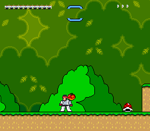
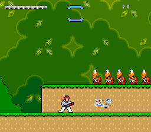

# Native SNES / Super Mario World ROM hack

This directory builds a **real 65c816 Super Mario World ROM patch**. It does not
use the C reimplementation, SDL, WASM, or an emulator-side overlay. Combat and
rendering run on the SNES CPU/PPU, with original SMW levels, physics, sprites,
music, saves, and overworld behavior retained where practical.

| Native Ryu | Native Shinku Hadouken |
| --- | --- |
|  |  |

These are framebuffer captures from the patched ROM, not mockups.

## Implemented

- All twelve fighters: Ryu, E. Honda, Chun-Li, Guile, Ken, Blanka, Zangief,
  Dhalsim, Balrog, Vega, Sagat, and M. Bison.
- Native title screen and six-by-two, map-backed character selection with all
  twelve portraits, selection highlight, blinking `1P`, and persistent fighter
  choice across native scene transitions.
- Native vitality, guard/chip damage, fresh-guard parry,
  combos, native score, super levels and buffered supers.
- Character-specific neutral, up, down and super moves, four projectile slots,
  carrying hooks, power-up meter gains, and Map16 attack handling.
- Imported 4bpp fighter/projectile/portrait/UI/Akuma art, palettes and twelve
  full-screen ending pages. No placeholder graphics are required.
- SPC700 streamed BRR audio for all 41 imported clips, including menu tracks,
  attacks, voices, supers and boss effects, while native SMW music continues.
- A custom C7 Akuma/Bowser finale with boss HP/phases, projectiles, reflection,
  damage, and a transition to the native ending renderer.

## Controls

| SNES button | Action |
| --- | --- |
| D-pad | Move / crouch / select a fighter |
| B | Jump (native SMW jump) |
| Y | Punch |
| X | Kick |
| A | Character-specific neutral special |
| Up + A | Up special |
| Down + A | Down special |
| R | Super, when meter permits; can be buffered during another move |
| L (hold) | Guard / fresh-guard parry |
| L + Y | Pick up a compatible object |
| Start | Pause / roster |
| Start + Select | Akuma practice finale |

## Build

Requirements: Python 3 and **Asar 1.91** on `PATH`.

Use an unmodified USA SMW ROM (512 KiB, optionally copier-headered). The build
validates SHA-1 before modifying a copy:

```sh
make rom SMW_ROM="/path/to/Super Mario World (USA).sfc"
```

If `local/smw-rebuilt.sfc` already exists from the project's pinned,
checksum-verified SMW disassembly build, plain `make rom` uses it instead.
`make original-assets` is the existing full asset/disassembly bootstrap and has
additional requirements; it is not needed when supplying your own base ROM.

Outputs, ignored by git:

- `local/smw-world-warrior.sfc` — expanded LoROM for a SNES emulator.
- `local/smw-world-warrior.ips` — patch for the verified USA base ROM.
- `local/smw-world-warrior.sym` — WLA-style labels for emulator debugging.

Apply the IPS with Floating IPS or another IPS-compatible patcher. No original
ROM or copyrighted SF2 sprite pack is included in this source directory.

Run artifact checks with:

```sh
make test-rom
```

These verify exact tile/palette sizes, the base hash, native hooks, unchanged
vanilla data outside declared hooks, embedded art, and IPS application round
trips. They do not replace emulator or hardware playtesting. See
**[HEADLESS.md](HEADLESS.md)** for the scripted scenes and WRAM/VRAM/CGRAM
assertions covering all fighters, endings, collisions and the finale. For the
separate hardware raster-time profiler and flash-cart measurement procedure, see
**[PERFORMANCE.md](PERFORMANCE.md)**.

## Implementation map

- `world_warrior.asm` — native hooks and expanded-bank layout.
- `smw.asm` — verified USA RAM locations, combat state and move constants.
- `main.asm` / `menu.asm` — input, roster, combat, boss and ending flow.
- `render.asm` / `graphics.asm` — descriptor resolution, OAM and NMI DMA.
- `roster_assets.asm` — generated graphics tables and bank-local art.
- `audio.asm` / `spc700.asm` — native SPC image, BRR transport and voice driver.
- `ending.asm` — full-screen ending pages and row-per-NMI uploads.
- `boss.asm` / `boss_gfx.asm` — Akuma AI, collision and presentation.
- `build.py` / `ips.py` / `test_rom.py` — validated build, patch and tests.

Graphics pointers use `$F0-$F2` and palette pointers `$F7-$F9`, not the
controller mirrors. Roster tables start at `$128000`, BRR data at `$6B0000`, and
ending tiles at VMADD `$4000` with tilemap `$7800`.

## Verification limits

- The all-roster move matrix, exact ending assets, native collision fixtures,
  audio transport, and C7 boss defeat/ending are exercised under Snes9x. This is
  not a full-game completion test.
- Native carrying, power-up meter gains, and the scripted Map16 attack fixture
  pass under Snes9x. Arbitrary Map16 interactions, SMW fireballs, capes, spin
  jumps, Yoshi rendering/riding and combat-specific presentation need further
  integration testing.
- Real-console/flash-cart timing and every boss/level interaction remain
  unverified. Emulator evidence is not a hardware-compatibility guarantee.
- This is not a feature-complete port of the desktop game, and no claim is made
  that Nintendo or Capcom assets are open-licensed. New code follows the
  repository's MIT license; Nintendo and Capcom retain rights in their games and
  characters.
